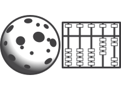
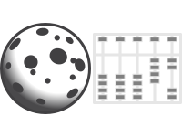

.. currentmodule:: cratermaker

.. ipython:: python
    :okwarning:
    :suppress:

    from cratermaker import cleanup
    cleanup()

.. _ug-counting:

Counting
========

The :py:class:`~cratermaker.components.counting.Counting`  class will be used to tally craters on the surface. It is currently under development, so not all of the core features are fully implemented. Rim measurement (fitting the rims of craters on the surface to measure their diameters and locations) is not currently available while it is being rewritten as part of the development of the improved morphology models. The :py:meth:`~cratermaker.components.counting.Counting.fit_crater` and :py:meth:`~cratermaker.components.counting.Counting.score_rim` methods remain available as tools.

Tracking emplaced and observed craters
--------------------------------------

One of the core responsibilities of the :py:class:`~cratermaker.components.counting.Counting` class is to keep track of the craters that have been emplaced onto the surface and to tally up the total population of craters that are observable on the surface at the present time. These are stored as two attributes, :py:attr:`~cratermaker.components.counting.Counting.emplaced` and :py:attr:`~cratermaker.components.counting.Counting.observed`, and are primarily meant to be used as part of a :ref:`Simulation <ug-simulation>` instance. The :py:attr:`~cratermaker.components.counting.Counting.emplaced` list contains all of the craters that have been emplaced onto the surface *in the current run interval*, while :py:attr:`~cratermaker.components.counting.Counting.observed` is a dictionary containing all observable craters on the surface as values and keyed by each crater's unique id. During a simulation run, craters are periodically tallied, and if they are determined to be too degraded to observe, are removed from the :py:attr:`~cratermaker.components.counting.Counting.observed` dictionary. 

The criteria for whether a crater is observable or not depends on the specific version of :py:class:`~cratermaker.components.counting.Counting` that is being used, however currently there is only one available ("depthcount"). The counting method uses the concepts of the "degradation state" and "visibility function" defined in Minton et al. (2019) [#]_. The degradation state is a measure of diffusive topographic degradation, but the current model uses the depth-to-diameter ratio as a proxy by way of eq. 9 of Minton et al., with a correction factor for complex craters from Riedel et al. (2020) [#]_. 

More Counting examples
----------------------

See more examples at :ref:`gal-counting`.

References
----------

.. [#] Minton, D.A., Fassett, C.I., Hirabayashi, M., Howl, B.A., Richardson, J.E., (2019). The equilibrium size-frequency distribution of small craters reveals the effects of distal ejecta on lunar landscape morphology. Icarus 326, 63-87. `doi:10.1016/j.icarus.2019.02.021 <https://doi.org/10.1016/j.icarus.2019.02.021>`_
.. [#] Riedel, C., Minton, D.A., Michael, G., Orgel, C., Bogert, C.H. van der, Hiesinger, H., 2020. Degradation of Small Simple and Large Complex Lunar Craters: Not a Simple Scale Dependence. Journal of Geophysical Research: Planets 125, e2019JE006273. `doi:10.1029/2019JE006273 <https://doi.org/10.1029/2019JE006273>`_

.. ipython:: python
    :okwarning:
    :suppress:

    cleanup()
