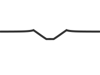

.. currentmodule:: cratermaker

.. ipython:: python
    :okwarning:
    :suppress:

    from cratermaker import cleanup
    cleanup()

.. _ug-morphology:

Morphology
==========

The Morphology component is used to alter the topography of a :ref:`Surface <ug-surface>` object using a :ref:`Crater <ug-crater>` object. The morphology model determines how crater geometry and ejecta are emplaced. Two models are available: "basicmoon", an axisymmetric model of lunar craters, and "realmoon", which adds the irregular shapes and textures of real fresh lunar craters (see :ref:`ug-realmoon`). Like other components, a :py:class:`~cratermaker.components.morphology.Morphology` model is generated using the :py:meth:`Morphology.maker() <cratermaker.components.morphology.Morphology.maker>` method:

.. ipython:: python

    from cratermaker import Simulation
    sim = Simulation(gridlevel=4, morphology="basicmoon", ask_overwrite=False, reset=True)
    print(sim.morphology)

Crater Emplacement
------------------

The main purpose of a Morphology model is to emplace craters on a surface. This is done using the queue-aware :py:meth:`~cratermaker.components.morphology.Morphology.emplace` method, which automatically handles crater preparation, overlap resolution, and surface modification. If you do not provide a surface object, the method will create a default one for you (see :ref:`ug-surface` for more details).

.. ipython:: python

    crater = sim.Crater.maker(diameter=25e3)
    sim.emplace(crater)

Internally, a morphology model maintains a queue of craters that can be processed in parallel batches, provided they do not affect overlapping regions of the surface mesh. This allows for physically plausible yet efficient crater emplacement across geologic timescales.

When a crater is emplaced, its ejecta is scaled so that its volume matches the volume the crater excavates, the pre-existing surface under the ejecta is degraded by diffusion, and slopes steeper than 40° are collapsed. These steps can be turned off with the ``conserve_volume``, ``do_subpixel_degradation``, and ``do_slope_collapse`` arguments of the morphology model.

Batch Emplacement
-----------------

You can enqueue multiple craters using :py:meth:`~cratermaker.components.morphology.Morphology.emplace`. Craters are emplaced in chronological order in batches of non-overlapping ejecta.

.. ipython:: python

    craters = [sim.Crater.maker(diameter=d) for d in (5e3, 10e3, 15e3)]
    sim.emplace(craters)

.. _ug-basicmoon:

The basicmoon model
-------------------

In the "basicmoon" model, a crater is an axisymmetric profile: a flat floor, a curved wall, a raised rim made of structural uplift and ejecta, and an ejecta blanket whose thickness falls off as a power law of distance. Complex craters and basins also carry a Gaussian central peak or peak ring in the basic profile. Each crater's profile parameters (floor depth, rim height, rim width, floor radius, and the shape of the wall) are drawn from size relations fitted to a curated set of fresh lunar craters, with the scatter between craters of the same size. The relations differ for simple craters (bowl-shaped, below about 14 km on the Moon) and non-simple (transitional and complex) craters, which have wide, flat floors.

Above the range of sizes of the fresh craters the relations are fitted to (138 km), the profiles move to those of the peak-ring basin Schrödinger (368 km) and the multiring basin Orientale (1020 km). Complex craters larger than about 200 km have a peak ring rather than a central peak: the peak opens into a ring between 200 and 300 km, at a little over 0.4 of the rim radius.

Multiring basins (larger than 500 km on the Moon) also have a ring scarp, the nested ring fault of Orientale's Outer Rook ring, set by three parameters alongside the others: ``scarp_radius`` (the radius of its crest, about 0.67 of the rim radius), ``scarp_height`` (the height of the crest above the rest of the profile) and ``scarp_width`` (the width of its steep, inward-facing face; its back slope is three times as wide). The scarp grows in as basins grow from 500 to 650 km. Because the final surface of a basin keeps little of the volume it excavated, basins are not held to volume conservation and keep Orientale's ejecta.

.. _ug-realmoon:

The realmoon model
------------------

Real craters are not axisymmetric. Their rims are polygonal, their walls are terraced and slumped, their floors are hummocky, and complex craters have central peaks. The "realmoon" model adds these features to the basicmoon crater:

.. ipython:: python

    sim = Simulation(gridlevel=4, morphology="realmoon", ask_overwrite=False, reset=True)
    crater = sim.Crater.maker(diameter=60e3)
    print(crater.morphology_type, crater.peak_height, crater.peak_width)

A realmoon crater is built from three parts:

- **The basicmoon profile**, with the same size relations, warped by an irregular rim outline.
- **A random field of variation around the profile** (the H-field), which holds the terraces, slumps, and texture of the walls and floor, and the texture of the ejecta. It is drawn from an empirical model of the topography of fresh lunar craters as a function of size and morphology type: for each azimuthal wavenumber, the covariance of the variation between radii, decomposed into radial modes. Two craters of the same size have different shapes, but the same statistics.
- **A central peak or peak ring** (for transitional and complex craters and multiring basins), built on the surface after the crater forms. Columns are raised where a noise field exceeds a threshold, shaped by a Gaussian envelope, and relaxed by slope collapse into a patchy, rugged massif of height ``peak_height`` and width ``peak_width``. The peak's volume is taken from the crater floor. The envelope is offset to a ring of radius ``peak_ring_radius`` in craters larger than about 200 km (see :ref:`ug-basicmoon`), giving a peak ring instead of a central peak.

The rim outline and the field are drawn when they are first needed and kept with the crater (``crater.hfield``), so a copy of a crater has the same shape. They are drawn only to the resolution of the surface where the crater forms: on a coarse surface, as here, a crater's field has only a few components, while on a fine surface it holds detail down to the size of the faces.

.. ipython:: python

    rim, field, rho_max = crater.hfield
    print(rim.shape, field.shape)

The ejecta zone of a realmoon crater is the pre-existing terrain, buried under the ejecta and degraded by it, plus the texture of the ejecta from the H-field, so craters formed on rough terrain inherit that terrain beneath their ejecta.

The H-field model is distributed with Cratermaker (``hfield_model.nc``). Another model file can be given with the ``hfield_model_file`` argument of the realmoon model, and the resolution the field is drawn to can be set with ``hfield_pix``.

More Morphology Examples
------------------------

See more advanced usage examples in the gallery: :ref:`gal-topography`

.. toctree::
   :maxdepth: 3
   :hidden:

.. ipython:: python
    :okwarning:
    :suppress:

    cleanup()
